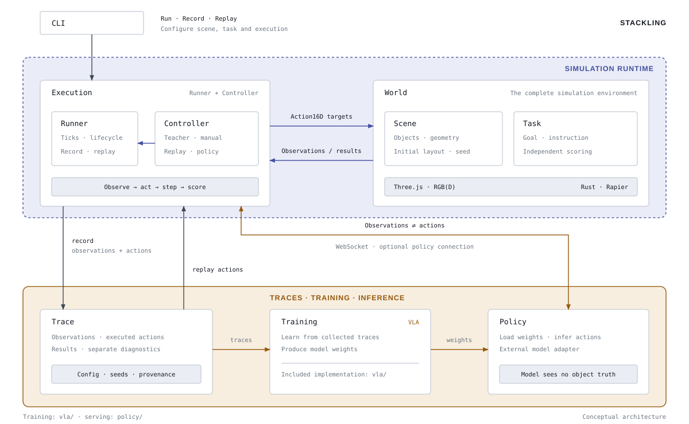

# Stackling

A robot stacking environment for interactive experiments and dataset collection. Native Rust Rapier runs the physical world and motors. Bun runs the shared TypeScript controllers, episode loop and task scoring; Three.js renders measured frames and captures RGB and optional depth. The browser, CLI and Python policy interface share one humanoid with an articulated waist, two physical arms and sixteen-value absolute actions.

The current physical environment is `stackling-v5.4`; its physics and observation contracts are in the [whole-body contract](protocol/whole-body.md).

## Architecture

World owns physics; Tasks owns prompts, structure recognition and independent scoring. The shared Runner schedules execution and recording; Render applies a replaceable theme to common task geometry and captures model observations.



## Getting started

Requires Bun 1.4.4+, a Rust toolchain (validated with 1.97.1), and Google Chrome or Playwright Chromium. Development, built-preview and CLI commands use the local Bun host and its compiled Rust module.

```sh
bun install
# If Google Chrome is not installed:
bunx playwright install chromium
bun run dev
```

The dev command builds the locked native module before starting Vite. For a built frontend, use `bun run build` followed by `bun run preview`; both preview and development provide the native host. Deploy the Bun host alongside the frontend and native artifact. See the [runtime contract](protocol/runtime-host.md).

Open the URL printed by Vite and click **Auto Stack**. The default scene has a motorized waist, two six-axis arms and two 5 cm cubes. The task selector offers equal-size stacking, count/color partitions, differently sized and ordered stacking, and maximum stable height. Settings adjusts the object count, scene seed and task parameters. The teacher selects the arm and grasp direction, with one object carried at a time. Instructions follow the interface language for new episodes.

All entry points use the same six task presets: equal-size stacking, count partitions, color partitions, different-size stacking, ordered-size stacking and mixed-object maximum height. Different-size and maximum-height tasks generate random dimensions; maximum height also randomizes shapes and scores the final stable height of any subset. See [Usage](docs/usage.md) for explicit CLI configurations and external-model binding.

Use the toolbar Theme selector to switch between Island and Studio between episodes; model images and recorded video use the selected theme. The desktop UI supports English and Chinese; use **Settings** to configure the scene and camera, and **Shortcuts** for manual controls.

## Collect, inspect and replay

```sh
bun run cli -- collect --out data/demo --seeds 42,2026
bun run cli -- inspect data/demo
bun run cli -- replay data/demo/episodes/000000
```

Task failures are saved alongside successes. Resume with the same collection command plus `--resume`; keep the configuration and source unchanged. Use `--task-preset partition-count`, `--task-preset stack-ordered` or `--task-preset max-height` to select another task from the CLI. See [Usage](docs/usage.md) for configuration, camera options, parallel collection and resuming, or run `bun run cli -- help`.

For result-only teacher or model benchmarks, use `evaluate`; use `collect` for complete recordings and `report` to summarize either format offline. See [evaluation usage](docs/usage.md#result-only-evaluation-and-reporting) and [Python Policy](policy/README.md) for model adapters and service setup.

## Connect a Python policy

The external service requires uv and Python 3.12. One command records a teacher episode (seed 42), exports the matching profile and serves the replay demo policy:

```sh
uv sync --project policy --locked
bun run cli -- policy-demo
```

The demo replays recorded absolute targets over the live connection, so the humanoid stacks the blocks. In the UI, open **External Policy**, connect, review configuration differences, **Apply & Bind**, set Scene Seed `42`, **Apply & Reset**, then **Run**. To connect from the CLI instead:

```sh
bun run cli -- collect --policy ws://127.0.0.1:8000/policy \
  --out data/demo-policy --seeds 42
```

External collection supports one worker with a fixed camera.

Implement `reset / observe / act / end` to integrate your model. Use its training Profile to establish compatibility; exporting current defaults does not establish compatibility with an existing checkpoint. See [Python Policy](policy/README.md) for custom factories and connection options.

## Documentation

| Resource                             | Purpose                                         |
| ------------------------------------ | ----------------------------------------------- |
| [Usage](docs/usage.md)               | CLI examples, configuration and collection      |
| [Architecture](docs/architecture.md) | Module boundaries, timing and dataset contracts |
| [Protocol](protocol/README.md)       | Policy Profile, WebSocket messages and encoding |
| [Python Policy](policy/README.md)    | Service setup and custom model integration      |
| [VLA Policy](vla/README.md)          | Training, serving and evaluating a VLA model    |

Training and model implementations are user-owned; `vla/` is one of them. DAgger, teacher takeover, independent gaze tracking, synchronized multi-camera capture and mid-episode snapshot recovery are not implemented.
