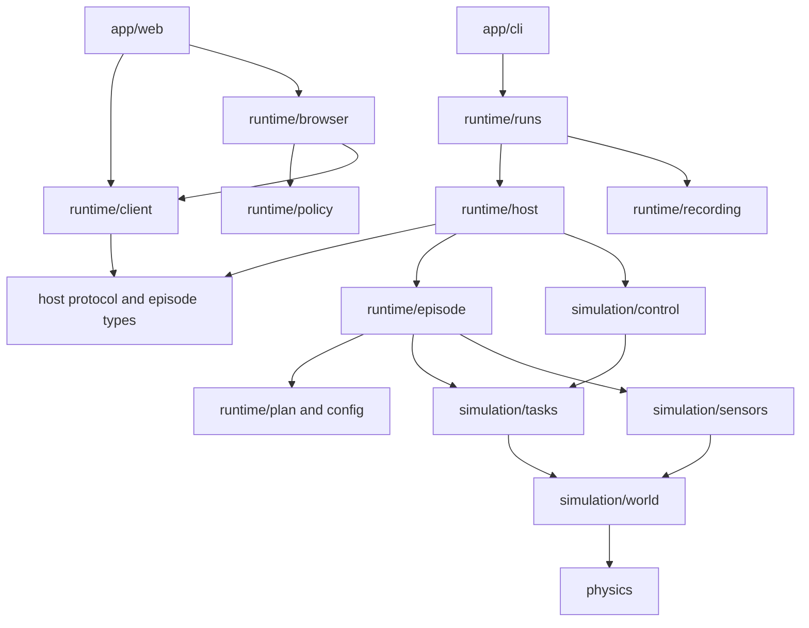

# Architecture

## Ownership and imports

| Owner | Responsibility |
| --- | --- |
| `physics/` | The Rust crate owns Rapier bodies, joints, motors, contacts and fixed physical steps. |
| `src/simulation/world/` | `Simulation` owns a mutable physical world. `WorldView` exposes measurements and neutral geometry. Only the host binding loads the N-API artifact. |
| `src/simulation/sensors/`, `src/simulation/tasks/` | Sensor specifications and transforms use world geometry. Task definitions recognize physical structures and score measured state independently of control. |
| `src/simulation/control/` | Manual and teacher controllers choose actions. Candidate search returns a grasp plan. The teacher executes it, monitors feedback and handles recovery. |
| `src/runtime/config.ts`, `plan.ts` | Resolve domain settings, scene seeds and immutable episode plans. Theme identity contains an ID, version and source checksum. |
| `src/runtime/episode.ts` | Schedules observations, actions, one fixed physics step, independent scoring and completion against simulation time. The host supplies an action source and optional sink. |
| `src/runtime/host/`, `client/` | Bun workers own mutable episodes and worlds. EpisodeClient and WorldClient consume measured frames through the shared host protocol. |
| `src/runtime/browser/`, `policy/`, `recording/` | Render and encode RGB-D frames, adapt policy requests, and persist or replay episode packets. A tick-indexed frame sampler shares a capture between recording and inference. |
| `src/runtime/runs/` | Assemble executors, commit results and resume declared seed plans. Headless teacher evaluation runs on Bun. |
| `src/app/web/`, `cli/` | Compose interactive desktop views and command-line operations. The web app owns edit transactions, policy review, permissions and playback pacing. CLI owns stderr progress and JSON output. |
| `policy/` | A uv-managed Python service loads individual models and returns validated absolute targets through the policy protocol. |
| `vla/` | A uv-managed Python package trains one such model from recorded demonstrations and serves it through `policy/`. It reads recordings and Profiles only; nothing in the simulator imports it. |

Arrows below denote source imports. Host and client exchange messages at runtime through their shared contract.

`bun run check:architecture` checks source ownership for value and type imports, module cycles and the transitive browser entry graphs. Theme source text and JSON schemas are resources. Worker URLs start separate graphs. The production build bundles the two HTML entries and the encoding worker.

## Configuration

`configs/default.json` and `configs/robot.json` define the `stackling-v5.4` physical environment for browser, CLI and policy Profile export. `src/runtime/config.ts` resolves typed partial overrides and validates them before execution. Resolved configurations require the articulated body, explicit motor/solver/mass properties, table width/depth/support and camera mount/head optics. Policy actions and measured states each carry sixteen values. Training Profiles and recordings bind to the physical environment fingerprint.

Robot actions contain waist yaw/pitch followed by each arm's six joint angles and internal finger gap. Per-arm seven-value types remain useful components of the sixteen-value world action. The authoritative ordering, units and recording layout are in the [whole-body contract](../protocol/whole-body.md).

The pedestal is fixed. Physical waist joints carry the torso, head and both arm chains. `src/simulation/world/mount.ts`, `src/simulation/world/geometry.ts` and `src/runtime/browser/render/humanoid.ts` share support/head/link dimensions; decoration does not add hidden colliders. Grasping uses actual bilateral finger friction. The teacher never attaches objects to a gripper, relocates rigid bodies to claim success or changes scoring thresholds.

`physics/src/config.rs` applies configured mass properties independently of collision envelopes. `physics/src/world.rs` measures normal contact force and tangential slip. `src/simulation/world/dynamics.ts` estimates static gravity and diagonal joint inertia for planning, including a carried payload. The [physical contract](../protocol/whole-body.md#physical-model-and-diagnostics) owns units, estimate provenance, jaw coupling and API measurement limits.

`physics/src/actuator.rs` owns the revolute joint encoder, reference trajectory and implicit force-based motor. Gravity feedforward is a spring-reference offset inside the same torque-limited motor as position/velocity feedback. Arm and waist torque limits therefore cover their combined actuation, while contact and joint-stop reactions remain physical constraints. No independent gravity torques are added to rigid bodies. Each physical step recenters the joint's local angular reference on its measured cumulative angle and expresses the remaining stops on that branch, preserving multi-turn limits without changing rigid-body poses.

The local reference rotation comes directly from the measured quaternion twist. Angular command and encoder inputs are rounded to Rapier's f32 precision before reference arithmetic; native `atan2` rounding differences therefore do not enter the physical commands. Observations retain the measured angle representation. CLI and browser execution use the same native module and shared Runner, including evaluation holds and recorded replay. Their measured frame views return independent pose values. The N-API step writes float64 measurements into a reusable caller-owned buffer. Buffer growth reads the current frame again without stepping physics. The host decodes complete collision and actuator measurements for control and scoring.

Waypoint references brake to their endpoint. Continuous references estimate velocity from successive control targets, feed it forward for one observed control interval, and settle to the final target if updates cease. Both arms and waist share these semantics and their configured speed/acceleration bounds. Each wrist excludes only its own internal housing contacts; opposite wrists still collide. Shared wrist envelopes cover the visible roll housing and pitch joint, and preflight uses the same per-arm collision exclusions. Horizontal grasps approach the upper side of low objects so the wrist clears the table.

Generation request version 2 is the current deterministic human-scale mixed/sized inventory generator. The previous generator is rejected. Explicit object dimensions are preserved. Crowded layouts restart deterministically every 256 attempts within the declared total attempt budget. Plans retain the resolved objects, seeds and generation identity.

## Time

Physics uses the configured fixed simulation timestep. Control and observation frequencies must divide physics frequency; their clocks remain independent. Every due observation is sampled before the control action at that tick, followed by the physical step and diagnostics. Target actions are never substituted for measured state.

`Episode.step()` is serialized inside its Bun worker. Browser rendering receives measured frames over the [runtime host protocol](../protocol/runtime-host.md); it has no Rapier WASM engine. Browser packets contain float64 body, TCP and joint measurements. Solver manifolds, collider transforms, actuator diagnostics and contact-force data stay in the host. Sensor callbacks install the matching tick before rendering and keep UI overlays separate. Awaiting policy inference or frame work does not advance simulation time or skip due observations. Pause gates action application and subsequent steps; resume does not issue the same action twice. Stop cancels pending work and ignores late responses. Simulation time defines task deadlines, trajectory samples and stability windows.

Whole-body planning is a generator. Node can drain it synchronously, while the browser yields computation under a wall-clock budget to keep UI input responsive. Yields do not advance physics, change candidate ordering or relax collision tests. Trajectories use local speed/acceleration bounds and continuous interpolation; exact endpoints and physical verification remain enforced.

UI playback speed changes wall-clock pacing and the number of scheduled steps processed, not the physics timestep. Host teachers batch due fixed steps through the native `advance` command, coalescing transport frames within an 8-ms work budget; unprocessed ticks stay due. Teacher playback retains elapsed wall time across delayed frames and planning instead of truncating the pending step budget. Each mode transition resets that budget and anchors a new playback clock; a pending pre-pause response cannot restore an obsolete budget after resume. Deferred work is drained through the same fixed steps. The render RAF is independent of the serialized episode pump so orbit controls and stop/pause remain usable during inference and planning.

Completion tasks finish only after independently recognized stable structures satisfy their configured stability window. The default window is one second across all task presets. Contact measurements reproject retained narrow-phase anchors using the current collider poses; recycled cached distances are not used as present-time separation. This measurement correction is part of environment `stackling-v5.4`, without changing physical integration or solver settings. Maximum-height tasks retain the full operation deadline, stop source callbacks at cutoff and record system holds through the subsequent stability-validation window. A timeout or teacher failure remains ordinary task-result data; infrastructure and configuration errors use nonzero process exits.

## Multitask contract

The six presets are equal-size stacking, count partition, color partition, differently sized stacking, ordered-size stacking and maximum height. They use tower, partition-count, partition-color and max-height definitions. Task definitions own prompts and scoring; the teacher does not decide whether a task succeeded.

Completion tasks require legal cube inventories. Ordered towers use the complete requested ascending/descending order; equal-sized objects are interchangeable. Count partitions match the declared tower capacities and color partitions forbid mixed-color towers. Physical support, stability and target structure are checked independently of planned placements.

Maximum height scores the final independently stable height of a valid subset. Mixed shapes, bridges and unused objects are permitted. Collapsed structures lose their earlier score. The operation deadline and validation interval are retained in results, including failed and interrupted attempts.

Whole-body planners propose task utility, object/support, pose and rejection identity without moving the world. The executor evaluates arm, waist, top/side/oblique grasp, clearance and transport costs, remembers waist direction and physically verifies release. Partition transfers use an actual table placement; only one object is carried at a time. Both arm chains remain active physical assemblies.

Cartesian IK samples are simplified within 0.002 radians (with scaled gap distance), then the resulting complete curve is collision checked again. Collision-free pickup joins approach and insertion into one path clock; dense curves and separate segments remain candidates when a shortcut or join intersects an obstacle. Candidate search first bounds the existing posture/travel preference, then evaluates withdrawal cost for the three fastest nominal pickup/carry/placement candidates. Withdrawal previews substitute the released object pose in collision queries without changing measured physics; complete paths are still planned against the live scene before execution. Motion-only cost bounds prune candidates that cannot improve the incumbent. Tower base utility includes both total and farthest remaining travel. An extended empty arm can fold during the other arm's collision-checked pickup. Initial settling requires 0.2 continuous stable seconds by default. Lower control rates slow the teacher path clock to retain the reference 20-Hz command density without changing physics or observation clocks. Every path endpoint must be submitted to the actuator boundary before the teacher advances its phase.

`src/simulation/control/body-planning.ts` constructs monotone quintic segments with shared knot velocities and zero knot accelerations. Subdivided Bezier derivative bounds enforce planned gripper speed and rotational joint speed, acceleration and jerk limits over complete segments. At path samples, configured mass properties and a carried payload estimate gravity and diagonal joint inertia; retiming reserves 30% of remaining motor torque, and statically overloaded samples make the path infeasible. This is a planning estimate, not full inverse dynamics: it omits cross-joint/Coriolis terms and does not guarantee physical joint jerk. Rapier still solves actual dynamics.

Teacher version 7 advances a separate path clock in simulation time. Saturated PD demand with tracking lag slows that clock; detected carry slip also slows it. Rate changes are slewed, while task deadlines, scoring windows and physics/control/observation clocks keep advancing normally. `src/simulation/control/grasp-feedback.ts` returns ordinary gap targets using measured bilateral normal force, object weight, manifold friction and slip. It increases force demand on slip within the physical motor budget. Closing requires sustained bilateral force and low slip; transport detects sustained loss of either jaw. These signals are privileged teacher feedback and do not expand policy observations or introduce object attachments.

Placement reduces the carry-specific slip boost. If a settled payload remains just above its destination after the planned descent, the teacher can make up to three small, collision-checked TCP corrections using the measured object pose calibrated to the forward-kinematic frame of the current planning joint targets. This keeps the virtual payload at its measured world pose when planning starts, while standard observations retain measured State16D and physical TCP data. After three correction attempts, a positioned, slowly moving payload within 2 mm above its intended support may unload through a bounded gap increase. Actual support must still persist for 0.25 seconds before the full opening command. Placement and release use joint/gap targets and ordinary physics; rigid-body poses, task deadlines and independent score thresholds are unchanged.

A released placement is committed once after the existing 0.5-second measured placement verification. At a submitted withdrawal endpoint, the teacher can plan the next pickup directly; when no continuation is feasible, it executes the remaining collision-checked escape/return segments and replans. No candidate path cache survives a physical step. A missing withdrawal after normal opening enters measured release verification instead of aborting a final tower before scoring; unverified placements remain subject to the original phase and episode timeouts. The Episode scorer alone determines task completion.

Task/prompt/teacher/theme versions are independent provenance identities, not interchangeable environment-version numbers. Teacher preference search is offline deterministic parameter evaluation over the same Episode loop. Candidate policies are compared on disjoint training/validation/test seed plans; failed outcomes remain in denominators. Selection cannot exchange reliability or stable height for less measured motion. Applying a selected policy is explicit and does not alter physics or task rules.

## Observations and cameras

Main-viewport orbit/first-person selection is independent of the capture camera. Capture may use an external camera or the robot's central head lens. Head optics stay fixed relative to the torso and move with the physical waist; there is no independent gaze tracker. Real arm occlusion remains visible.

`src/simulation/world/mount.ts` owns the optical mounting frame used by rendering and calibration. RGB and depth share exposure, clipping planes and resolution. Model RGB is PNG RGB8; depth is gzip uint16 millimetres, with zero invalid. Main-view overlays use a separate render layer and never enter captures.

Every observation carries measured State16D and the exact sensor camera-to-world transform at that observation tick. Wire/calibration flat matrices use Three.js column-major elements; the Python adapter exposes a float64 4×4 matrix. Dataset matrices use conventional row-major `[observations,4,4]` storage. See [Protocol](../protocol/README.md) for field definitions and [whole-body recording](../protocol/whole-body.md#dataset-schema-10) for NPZ layout.

Calibration describes intrinsics and the neutral mounting pose. For a moving head camera, models must use the per-observation transform rather than assume neutral extrinsics stay constant. External cameras supply the same field, constant while their capture configuration is fixed.

FramePipeline is the sole capture/encoding path for UI, full collection and external-policy evaluation. It caches per-tick captures, keeps asynchronous GPU readback bound to its issue tick, and preserves independent observation/control rates. Encoders and image compression do not change simulation clocks. RGB-D preview display limits do not change recorded depth values.

## External policies

The browser, CLI and Python service use `stackling.policy`. The schema in `protocol/schema.json` defines the WebSocket messages and the complete Profile. Python distributions package that same file.

Profile configuration fixes physics, robot, camera and control/observation rates. Training tasks/appearance are immutable provenance, not an execution allowlist. Episode tasks, objects, seeds, time limits, prompt language and actual themes may vary independently while preserving the Profile runtime contract. Core compatibility remains strict.

The Python model factory loads once. `reset`, `observe`, `act` and `end` are synchronous callbacks serialized by one service executor. Models receive prompt text/language/time budget, measured state, RGB/depth and sensor calibration/pose. They do not receive structured goals, object truth, teacher objects, theme labels or privileged WorldSnapshot diagnostics.

`act` returns `ActionTarget` with sixteen absolute values and the explicit `continuous` motor-tracking flag. Both modes use the same limits and units; the flag preserves waypoint-versus-continuous tracking semantics during live control, recording and replay. Normal waypoint targets use false; sampled continuous trajectories may use true.

The TS adapter validates every target at the policy boundary. The shared Runner owns the simulation loop and applies valid targets without changing world/scoring semantics to accommodate a model.

The service permits one active client and one episode. A slow model callback cannot be forcibly killed; stop/disconnect retains its lease until cleanup completes, and the client discards late replies. Requests have matching session, episode, request and control/observation identities. Model revisions are immutable for a service process and change when weights change.

## Plans, recording and evaluation

`src/runtime/plan.ts` resolves the immutable case × seed × camera plan before execution. Resolved initial objects, bilingual prompts, generation identity and actual appearances are recorded. Training and actual source identities remain separate.

Collection uses one host `run` request per episode. The host advances the shared Episode loop and awaits exact-tick sensor and policy callbacks while accepting pause and stop commands. Full recordings use dataset schema 10. Action and diagnostic rows are batched directly from the episode worker to the registered host writer, with bounded buffering and write acknowledgements. The final partial batch drains before completion. Browser uploads supply the observation pixels and video through the same serialized writer. Each episode stores complete metadata, video and NPZ arrays, including sixteen-value measured states, executed targets, teacher labels when applicable, tracking flags, physical diagnostics and per-frame camera transforms. Diagnostics are privileged; they must not become standard model inputs. See [Usage](usage.md#data-and-resuming-collection) for file encodings.

Result-only evaluation uses its own `kind: "evaluation"`, schema 2. It shares planning, scheduling, physical scoring, provenance and atomic result handling, but stores no frames/actions and cannot be replayed. Node teacher evaluation does not construct capture/encoding pipelines; external-policy evaluation still supplies live observations without recording video.

Episodes are written to exclusive partial directories, then atomically committed after all declared outputs and checksums are complete. The run manifest stores one SHA-256 checksum per indexed episode. Resume verifies each indexed record and recovers complete episode directories committed before the index update. Index/metadata inconsistencies, changed source/configuration/model identity and incompatible resume plans are errors. Interrupted/failed episodes retain partial evidence and reasons; no failed seed is silently replaced by a successful retry.

`inspect` validates format, hashes, action/state widths, clocks, camera transforms and provenance. `replay` uses the recorded resolved initial scene, absolute targets and tracking flags through the same physical loop, then checks joints, gaps, object states and camera poses. `report` aggregates recorded task results without simulation or model connections and does not mutate episodes.

## Provenance

The environment compatibility fingerprint includes physical World implementation/validation, Rust sources and locked dependencies, the native bridge/build identity, shared render/sensor helpers, runtime defaults, robot description, Episode scheduling, capture/encoding and exact Three/fflate versions. It excludes task definitions/prompts, scene generation, UI, documentation, Python model code and independent theme registration/content. It identifies a build rather than a contract: `runtime/policy` enforces the Profile configuration, and the application layers report a Profile fingerprint that differs from their build, as described in the [protocol](../protocol/README.md).

A separate full-source hash covers source, configurations, all shared protocol files and build inputs. It detects incompatible collection/resume changes even when model runtime compatibility is unchanged. Each dataset keeps the hashes recorded by its producer.

Appearance identity records theme ID, version and raw source hash. Actual appearance contributes to episode/configuration identity, while immutable training appearance remains unchanged during evaluation. Task additions do not redefine a model's runtime; source and episode-plan checks still preserve dataset reproducibility.

## Browser UI

The desktop interface uses shadcn/ui/Radix, shared bilingual resources and restrained theme tokens. Shared state permissions gate buttons, commands and keyboard entry points. Running, paused, editing and connection transitions have explicit permissions; policy state is not inferred independently in individual controls.

Configuration drafts are separate from applied settings. Preview edits do not mutate the active physical world; Apply validates/prepares replacement resources before committing, and Cancel restores the original scene and view. Restore Defaults keeps the selected task family and current theme. Bound policies lock camera/physics/rates while still permitting independent task and appearance choices between episodes.

The main viewport has separate overview and head cameras. Switching views preserves orbit pose and never changes captured observations. Keyboard Cartesian control operates the negative-X arm through whole-body kinematics, preserving the waist and other arm target.

## Theme plugins

Render owns shared robot, table and task geometry. Island and Studio supply materials, light/background parameters and independently disposable decoration. Task-object semantic colors and all physical colliders remain common. The robot palette, support envelopes, head optics and both working arm/finger builders have one shared implementation.

Decoration receives a frozen scene layout without physics, control or task truth. It cannot add task colliders or hide privileged state in sensors. Main-view markers/labels are separate overlay objects. No retired theme is silently aliased to a current one.

Theme changes are allowed between episodes under the shared permission rules. Resources are prepared before committing, old decorations/materials are disposed, and visual revision invalidates renderer-specific shadow and frame caches without advancing physics. Physical state, camera and episode identity remain intact. Plugins are statically registered; raw source hashes and exact theme versions preserve appearance provenance.

## Collection workers

The browser launcher waits for Vite's static request crawl to become idle before closing its browsers and dev server, including cold and completed-resume shutdowns. Each browser worker owns its own simulation, render/capture pipeline and output session. Parallel collection is explicit; the shared GPU can lose throughput under contention. On supported multi-GPU Linux hosts, BrowserHost pins workers to GPUs through private mount-namespace device masking; otherwise it reports the configured fallback. Throughput depends on the hardware; parallel scaling is not guaranteed.

Metrics distinguish simulation time, elapsed time, frame counts, stage durations and process memory. Summed coordinator/descendant RSS can double-count shared pages and is not exclusive GPU memory. Progress/diagnostics use stderr while CLI result JSON uses stdout. Generated measurements, reports and screenshots stay outside Git.

## Physics build identity

The locked Rust crate builds through `bun run build:physics`; the loader checks source and binary hashes at the native boundary. Build identity records compiler, flags, platform and architecture and participates in compatibility and recording provenance. Restart the host after changing Rust. A static frontend deployment requires the Bun host alongside its assets. The [runtime host contract](../protocol/runtime-host.md) owns transport, frame and lifecycle definitions.
